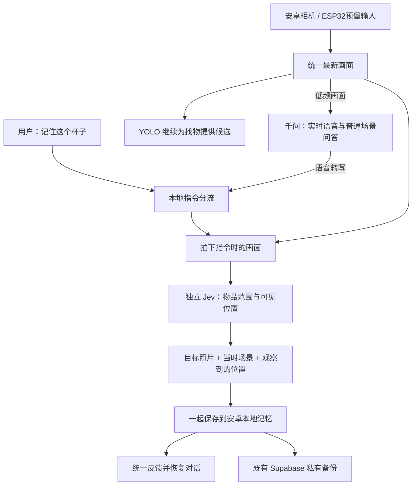

# 自动记住外观和位置

> 2026-11-02 现场验收更新：本版仍未完成可靠的自动记忆。用户实际操作出现“本地未保存、千问说记住了”的矛盾；数据库没有新增外观或自动位置。下文保留当时实现与固定图片检查范围，后续以 [重新梳理后的流程](memory-flow-reset.md) 为准。

版本：0.10.0-tablet-auto-memory，版本号 16。

用户只需对着物品说“记住这个杯子”。不要求说出地点，也不要求拍三个角度。

## 本轮修正的实际问题

0.9.0 把“一句话”实现成用户同时说出物品和地点，偏离了自动观察位置的需求。真实平板画面中，杯子清楚可见，但本地 YOLO 没有识别为杯子；录入又要求先有这一检测结果，导致位置能记、外观一直失败。仅使用假检测结果的流程检查没有覆盖这个真实问题。

本轮取景直接读取统一入口的最新画面，不再等待本地检测匹配，也不把 YOLO 推理后的旧帧作为录入前置条件。独立视觉接口在同一帧中判断要记住的物品范围，以及它与桌面、架子、抽屉等可见参照的关系。

用户已明确允许将本次固定杯子画面用于 OpenRouter Jev 测试。实际接口预检查 HTTP 200，找到了杯子范围，并判断为桌面上；该结果只证明这一张获准画面的能力，不能代替所有真实场景验收。现场图片仅保留为私有测试输入，不进入源码、安装包或公开交付。

## 当前流程

定位成功后，保存目标照片和当时场景；如果看见杯子在桌面上，就保存“桌面上”，位置来源为相机观察。照片与这一条位置一起提交，失败时不会只留下一个虚假的“已保存位置”。之前用户提供的位置历史继续保留。

用户拍下后挪开镜头，不会让已经拍到的历史画面失效。找物时仍要求当前画面与参考匹配，历史照片不能证明物品现在还在那里。

若视觉服务看见物品但看不清具体参照，会保存照片和当时场景，并明确说明位置未确定；不会编造房间、桌子名称。自动位置目前限于画面中可见的桌面、架子、抽屉、柜子、床、沙发、椅子、地面、手、包等参照与上下、内外关系。

## 后续对话

原来进入任务后会停止千问的播放器，但退出任务没有恢复；普通场景问题也没有解除任务抑制。现在保存完成或失败后恢复普通对话；用户接着问“桌子上面有什么”时，也会切回问答。语音转写已在千问中时不会再重复发送一遍文字。

本地保存播报期间暂停远端播放，播报结束后按原有用户播放偏好恢复，避免两路声音重叠。

这只是修复任务和普通对话之间的恢复，不代表完整自然语言意图理解已经完成。现有层仍主要是指令和指代规则；完整语义理解、多轮补充与任务切换已列入 [下一轮任务顺序](next-iteration-plan.md)，按用户要求在自动记忆之后处理。

## 数据与验证

数据库仍为第 3 版，不清空物品、历史或对话，不更改 Jev 和 Supabase 登录配置。用户自己提供的位置仍可以照常记录，来源与相机观察分开。

65 项基础检查和 84 项安卓检查已通过。小米平板保留数据更新后，独立数据区自动记忆与重开检查通过；获准固定杯子画面调用真实 Jev，保存目标照片、场景照片与“桌面上”通过。正式账号云端备份、下载核对及独立库恢复通过；正式库中的记录不一定都含照片，有照片恢复另由隔离数据检查。原有记录、92 条旧对话、加密 API 配置及登录状态保留。实时相机与口述连续操作不由这次固定画面回放代替。

构建、安卓检查、真实场景接口回放与更新后数据核对，以交付目录中的实际报告为准。独立数据库测试数据不写入正式记忆库；获准图片的回放也不冒充实时相机实物验收。

官方协议依据：[Jev Box](https://docs.typesafe.ai/primitives/box)、[Choice](https://docs.typesafe.ai/primitives/choice)、[OpenRouter Jev](https://openrouter.ai/docs/guides/community/jev)。
