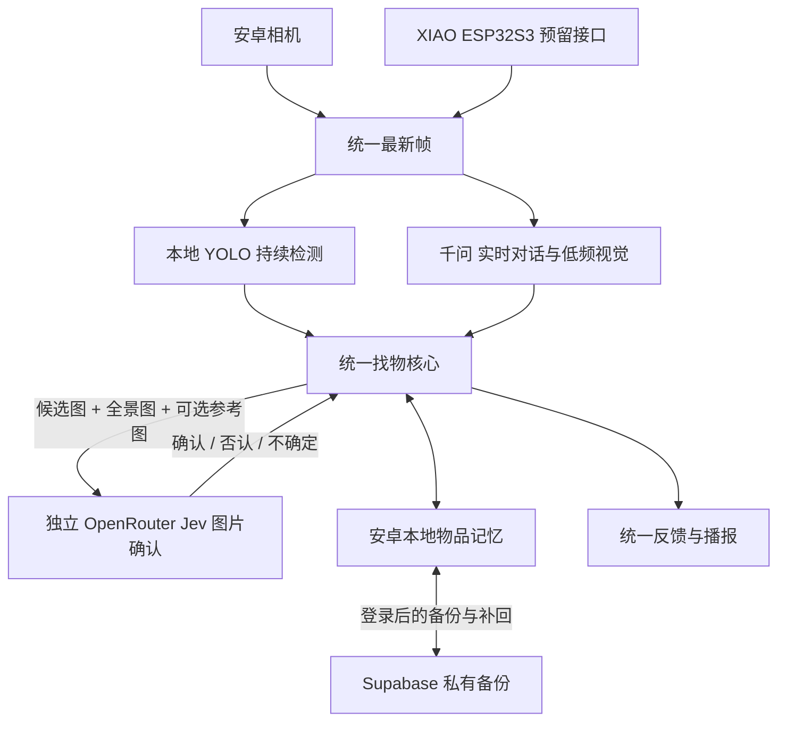

# 安卓备份与恢复阶段

日期：2026-11-01。测试版：0.8.2-tablet-backup，版本号 14。

## 架构与界面

沿用用户给定架构，不重新搭建应用。移除图片复核设置页与入口，后台固定使用已配置的 OpenRouter Jev。千问继续负责实时对话和低频画面理解。只有统一找物核心判断候选需要确认时，才向独立图片服务提交候选图、全景图和可选参考照片，返回确认、否认或不确定。

Supabase 只备份已保存的物品，不参与实时找物和图片确认。未登录或网络中断时，现有本地功能照常运行。ESP32 固件由队友开发，本轮只保留既有输入接口。

首页仍使用原来的“语音找物”和“对话记录”。没有增加图片服务按钮、备份设置页面或多套确认流程。备份命令使用已有对话输入，操作见 [一次性准备与使用说明](supabase-setup.md)。

## 备份范围与恢复规则

- 包含：每件物品的独立编号、名称和别名、外观特征、参考照片，以及追加的位置历史。
- 不包含：聊天记录、API 密钥、登录令牌、网络配置、当前摄像头画面或临时寻找任务。
- 每份备份限制 40 MiB；最多 500 件物品、每件 6 张参考照片、总计 20,000 条位置历史。超出时停止并保留原记录。
- 登录信息加密保存。文件空间为私有，每个账号只能读写自己的目录；客户端没有覆盖或删除已有云端备份的权限。
- 恢复前先核对账号、文件完整性、照片和目录。只补回缺少的物品编号，现有同编号记录保持不变；同名但不同编号的物品继续分开，重复恢复不会重复添加。
- 位置恢复后仍是历史信息，不能据此宣称物品现在还在原位置。

应用运行期间，记忆发生变化后会安排自动备份；离线或退出时保留本地数据，再次打开重试。这一版没有承诺应用被系统结束后仍持续在后台上传，也不提供跨设备的实时合并或删除同步。

## 登录与连接

用户已报告完成 SQL 准备。默认邮件模板被 Supabase 锁定，0.8.1 支持默认邮件按钮链接，不要求先配置 SMTP 或修改模板。首次登录仍需要收件人验证邮箱；默认发信服务只允许组织团队邮箱，并有发送频率限制，正式给更多用户使用时需准备自己的发信服务。

平板直连 Supabase 曾中断。现通过项目现有 Cloudflare 服务转发固定项目必要的登录和私有备份接口，平板实际连接检查通过。Supabase 继续验证登录身份和账号访问权限；没有修改平板全局网络设置，没有使用管理员密钥。

0.8.1 将本地登录申请只保留 15 分钟，导致用户稍后粘贴邮件链接时被要求重新申请，加剧默认发信限额问题。0.8.2 把本地等待改为一小时，兼容前版已保存的申请；同邮箱未完成的有效申请直接复用。服务端仍验证邮箱、一次性链接和实际有效期，不延长服务端令牌寿命。明确需要新链接时才使用重发命令，并在本地保存发送冷却时间。错误提示区分邮件发送额度和普通请求限制，保留已有本地记忆。

## 已完成验证

- 构建、55 项基础检查、静态检查和安装签名通过。
- 独立模拟设备 60 项安卓检查通过，覆盖原有图片服务、独立复核、恢复完整性、同名物品、重复恢复、错误账号、损坏照片、危险目录、数据库冲突回滚、加密登录、邮件链接和本轮五项登录等待及限额检查。
- 服务接口此前 21 项检查通过，覆盖千问与 Jev 分工，以及固定备份项目、受限请求、上传不覆盖、拒绝跳转与私有下载。本轮只调整安卓登录，服务端实现与部署版本未改动，沿用同版本检查证据。
- 实体 Pad 5 上独立临时数据库的本地往返检查通过：2 件同名物品、6 张照片、4 条位置历史，重开及重复恢复通过。临时样本未写入用户真实物品库。
- 新版已在 Pad 5 保留数据更新。平板连接 Supabase 检查通过，服务端接受了一次登录邮件请求；这不等于已收到邮件或完成登录。
- 0.8.2 真机第一次申请新邮件成功；随后同邮箱重复申请返回复用原申请、没有再次发信，等待状态仍有效。修复没有靠关闭邮箱验证或提高服务端限额实现。
- 随后用户完成邮箱验证，真机状态确认已登录、没有待验证申请。真实账号的私有快照上传、列出、下载摘要核对、恢复到独立临时数据库均通过；同一云端文件通过公开地址匿名读取被拒绝。

这次真实账号检查时，正式物品库为 0 件，因此云端往返使用真实空快照；没有向正式物品库或真实云端目录写入假物品。含 2 件同名物品、6 张照片与 4 条历史的恢复在真机独立临时数据库中验证，不应说成有真实物品的云端验收。未测试两个真实账号之间的隔离；正式物品的跨设备恢复、识别准确率、遮挡和移动场景仍需后续实际使用验证。

## 相关文件

[私有文件空间准备 SQL](../supabase/migrations/202611010001_memory_backups.sql)、[GitHub 参考范围](github-reuse.md)、[完整开发状态](android-development-status.md)。0.8.2 构建与设备检查证据在本机 `output/android-backup-login-fix-2026-11-01` 中，前一版记录保留在 `output/android-backup-2026-11-01`。私有数据副本不进入交付。
