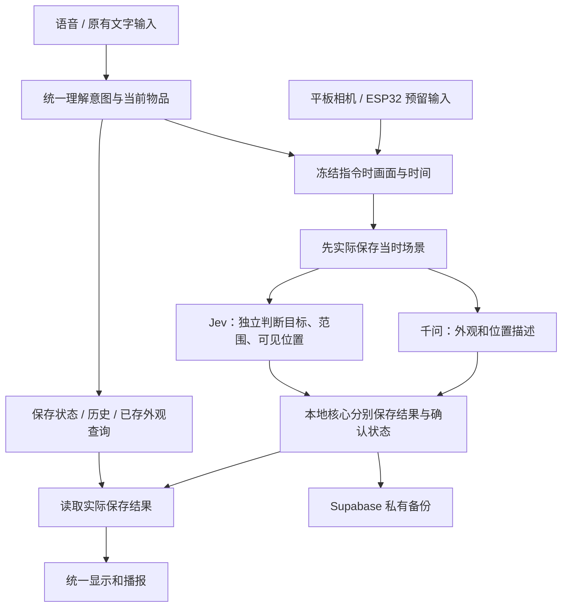

# 统一理解、保存和回复的记忆流程

版本：0.11.0-tablet-controlled-memory，版本号 17。本文记录本轮实现，最终构建和真机结果以本轮交付报告为准，不将模拟器或固定图片单独视为现场完成。

## 用户怎么使用

打开原有“语音找物”，对着物品说“记住这个杯子”。不要求三个角度或口述位置。

应用先把当时画面保存到本地，再分别处理外观和位置。物品照片没裁出来时，场景仍然保留；位置确认了也能单独记下。位置看不清不会编造；可以继续问“你记住它了吗”“它上次在哪里”“它的外观是什么”。这些问题查的是实际记录。

“杯子现在在哪里”会开始看当前画面找物；“桌子上面有什么”是当前场景描述，不改长期记忆。当前选中的物品用于理解“它”“那个”，确实存在同名歧义时仍需明确是哪一件，不凭类别覆盖旧物品。

## 一个回复出口

千问提供语音转写、补充意图理解和画面分析。程序不再直接播放千问生成的音频，也不把自由聊天文字当成保存结果。只有应用核对后的结果进入原有显示与播报出口。

本轮采用应用统一播报，因此声音可能与先前千问直接说话的音色不同。原来的朗读偏好仍然保留，不增加图片复核设置页或新的首页按钮。

收到指令先尝试本地明确分流；较自然的说法在语音已连接时交给千问返回限定的操作类型，由本地再次核对目标与参数。模型不能直接写库、删除记忆或把推测地点伪装成用户亲口提供的位置。模型提出的地点若要作为用户陈述，必须能在用户原话中找到，且不能是“可能”“好像”等不确定表述。

千问的意图结果必须匹配本次请求编号；图片描述通过独立请求把本次唯一画面与问题一起提交，结果必须匹配画面编号。不属于当前请求、过期或重复的结果不被接受。没有得到可靠意图时给出简短澄清，不自由回答“已经记住”。

请求先通过 `conversation.item.create` 写入本次消息，再以 `response.create` 触发分析；不把本次问题塞进服务不支持的逐次指令字段。参照 [千问官方事件说明](https://help.aliyun.com/en/model-studio/client-events)。音频接收使用外部播放方式，千问输出不会直接送到扬声器。

固定图片描述使用项目已有的千问图片接口，每次只发送这一张画面及对应问题，避免视频流缓冲与文字问题错开。实时通话继续负责转写和意图理解，低频固定画面由千问单独描述，Jev 仍独立核对。不需要部署新服务或把服务器密钥装入平板；图片描述不依赖语音连接是否成功。

## 自动记忆顺序

场景照片和精确目标照片分开存放。整张桌面不能被当成杯子本身的参考外观，避免以后拿桌面特征判断“同一只杯子”。Jev 的“目标可见”“目标范围”“可见位置”也分别处理，不再把所有不确定都解释成“请完整入镜”。

Jev 确认的可见位置写为相机核实；千问描述的细节如果未经独立确认，只作为待确认线索。历史时间保留实际取景时刻，不因分析需要几秒钟就把它伪装成后来的当前位置。找物时仍重新核对当前画面。

## 保存状态

| 实际保存情况 | 反馈原则 |
| --- | --- |
| 场景、目标照片、确认位置均已保存 | 可以说“已记住外观和位置” |
| 场景和位置已保存，目标照片没有提取出来 | 明确位置已存、目标照片待补充 |
| 场景和目标照片已保存，位置未确认 | 明确外观已存、位置待确认 |
| 只有当时场景 | 明确画面已存，外观与位置未确认 |
| 最初的画面就没有保存成功 | 明确本次未完成，不宣称成功 |

取消或后来修改物品时，迟到的分析不能覆盖新记录；已实际保存的场景保留。网络或分析失败不清除场景，也不清除原有位置历史。相机没有开启、指代没有明确目标时，会说明当前缺什么。

“记住了吗”查询照片、场景和位置的实际状态；“上次在哪里”读取带来源和时间的历史；不能用千问会话中曾经说过的话代替这些记录。

## 数据与备份

本地数据库从第 3 版升级到第 4 版，新增独立的场景记录，原物品、外观、位置和对话不重建。升级前保留可校验的旧数据库副本。新场景图片仍放在本应用私有目录。

备份文件格式升级到第 2 版，包含场景、目标照片、描述和各自状态；保留读取第 1 版旧备份的能力。Supabase 项目、账号登录、私有文件权限和现有服务端不改动。恢复继续只补充缺失的物品，不覆盖本地已有的新编辑。

自动备份也观察场景状态的变化，只有画面或部分确认的记录同样会进入备份。

诊断只记录结果类别、耗时和判断数值，不默认记录新的现场图片或语音。正式记忆和独立检查数据分开，检查用数据库不会作为正式物品留下。

历史失败与设计依据见 [流程重新梳理](memory-flow-reset.md)，后续任务见 [下一步计划](next-iteration-plan.md)。
