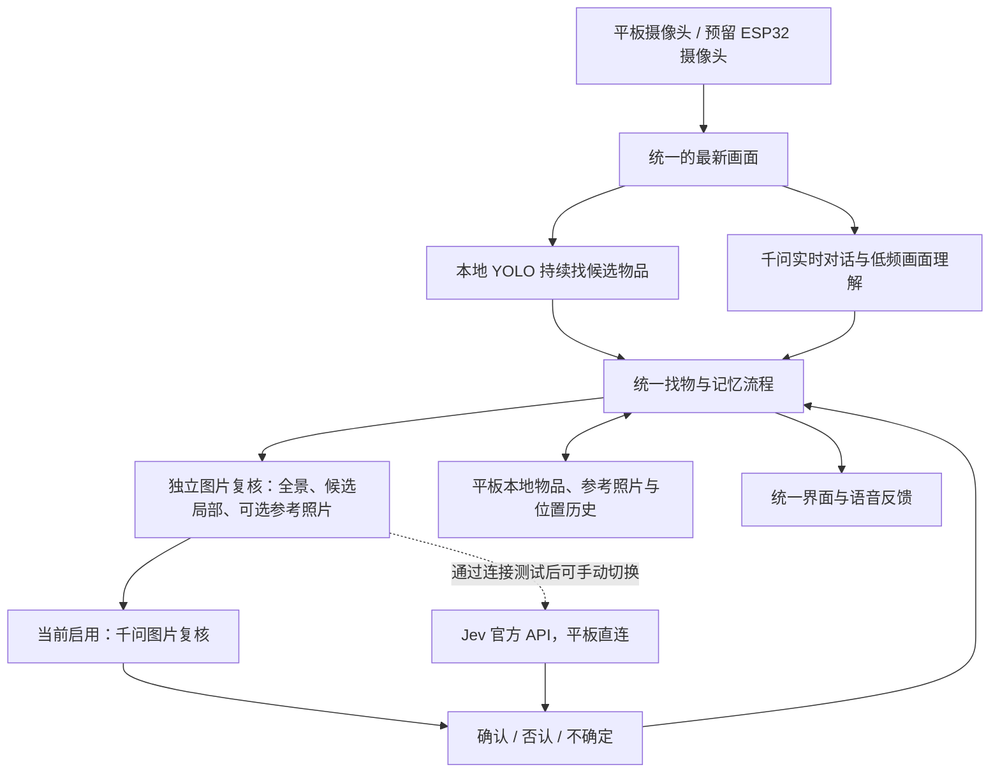

# Jev 平板直连：0.7.1

验证日期：2026-11-01。设备：小米 Pad 5，Android 13。

本轮已实现并安装 Jev 官方 API 直连，但**当前平板网络请求返回 HTTP 451，Jev 尚未启用**。原有千问对话与独立图片复核继续使用。不能将此结果写成密钥无效、余额不足或 Jev 已完成真机验收。

## 现在的架构

- 千问实时对话和图片复核相互独立；语音断开不应阻塞图片复核。
- Jev 被选中后只接管候选图片判断，千问继续负责实时对话。不向 Jev 连续上传视频。
- “平板直连”仍会通过网络把指定图片发送给 TypeSafe；本轮没有把 Jev 模型离线运行在平板中。
- 同时只选择一个图片复核服务。Jev 否认或不能确定时，不自动改问千问来获取肯定答案。
- 摄像头来源、找物核心、保存、同名物品和位置历史沿用已有结构，无需整体重建。ESP32 固件与 Supabase 均未修改。

## 本轮完成的部分

1. 新增 Jev 1.14.0 官方原生图片请求：当前全景、候选局部、最多三张历史参考照片分开提交。要求清晰且证据充分；同类、同色不足以证明是同一件物品。
2. 新增“图片复核设置”：保存密钥、测试直连、启用已通过测试的 Jev、切回千问、移除本应用 Jev 密钥。
3. 密钥由平板系统的安全存储加密保护；没有写入源码、安装包或普通日志。已在这台平板以加密方式导入用户提供的密钥，不通过剪贴板或输入法传递。
4. 连接测试使用应用生成的图案，不调用相机、麦克风，也不建立千问语音会话。成功条件包括普通图片和带参考图两种复核。未通过前不能启用 Jev。
5. 请求取消会终止网络调用；不跟随跳转发送密钥；报错不显示服务方原始响应。保留已有画面过期和任务取消保护。

## 真机结果与使用方法

平板已经实际访问 `https://api.typesafe.ai/v1/systemone`，收到 **451 / region_restricted**。测试在第一张生成图处结束，没有执行参考图比较，也没有真实物品准确率结果。当前复核模式仍是 `qwen`，密钥已保存但没有通过验证。

进入应用右上角 `•••` → `图片复核设置`。当前密钥已配置，可直接点击“测试 Jev 平板直连”。只有实际测试通过后，再点击“启用 Jev 直连复核”。该选择只改变图片判断服务。不要将电脑上能调用的结果当成平板当前网络也能调用的证据。

本次没有修改平板的代理、DNS、VPN、网络配置，没有购买会员或充值，也没有增加转发代理。下一步若要启用 Jev，需要 TypeSafe 官方支持这台平板实际使用的网络地区，再从应用内重新验证。

归还借用平板前，可在本应用内选择“移除本应用保存的 Jev 密钥”；此按钮只处理本应用的 Jev 配置和密钥，不删除物品或对话记录。

## 已验证与边界

- 55 项核心检查通过；静态检查和安装签名通过。
- 模拟器 33 项安卓检查通过：包括直连请求、参考图隔离、含糊结果、取消、跳转与地区错误处理、密钥加密及防重复导入，以及原有记忆保存和图片复核检查。
- 针对 Android 13 补充了真实启动入口检查。前一版测试指令在发出 API 请求前被安卓拒绝；已修正后再执行上面的真机联网测试。
- 0.7.1 已在实际平板保留数据升级并打开；核对安装包与构建产物完全一致。
- 数据库完整且仍为第 3 版；原有三条对话内容完全相同；升级前后物品和位置表均为空，没有为了测试在真机写入假物品。
- 本轮没有在平板安装自动检查辅助包，没有清除数据或更改其他应用；结束时本应用相机与麦克风均未运行。
- 联网失败是已确认的限制。不能把模拟响应测试、电脑成功调用或生成图测试等同于真实物品准确率验收。

## 下一步

先用当前可用的千问复核完成真实物品对照：不同外观的同名物品、相同颜色的不同物品、遮挡与模糊、移动后的历史位置，以及关闭语音后的独立复核。逐项记录是否误认、是否正确拒绝、保存是否完整和等待时间。

Jev 在官方允许的网络条件下复测通过后，再用同一批物品比较效果与等待时间，决定默认服务。ESP32 队友提供图像接口后，只接入统一画面来源，不复制找物和记忆逻辑。Supabase 留到多设备同步需求明确后接入，不阻塞目前的本地版本。

相关官方资料：[TypeSafe 图片请求](https://docs.typesafe.ai/images)、[Noul 概率](https://docs.typesafe.ai/primitives/noul)、[Android 安全存储](https://developer.android.com/privacy-and-security/keystore)。
