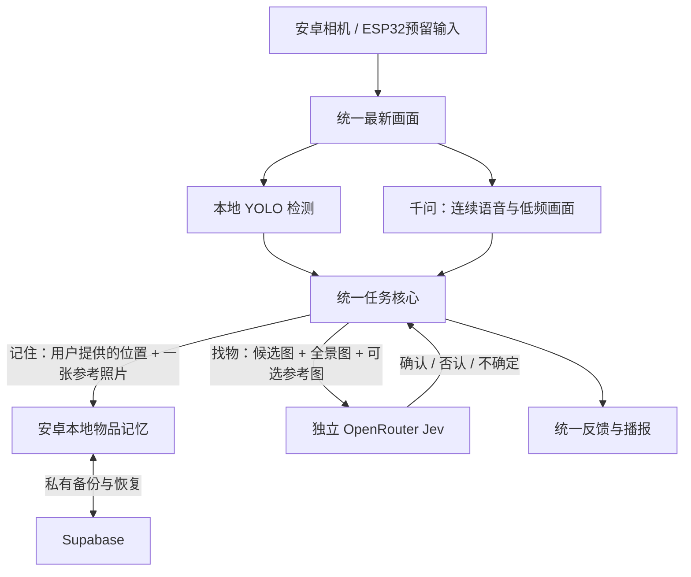

# 一句话记住物品

> 本文保留 0.9.0 的历史实现和当时检查范围。当前 0.10.0 已改为自动观察外观和位置，不要求说出地点；请以 [当前自动记忆说明](android-automatic-memory.md) 为准。旧版对真实杯子的漏检问题及修正已在新说明中记录。

版本：0.9.0-tablet-memory-once，版本号 15。开发日期：2026-11-01。

## 之前为什么保存不了

之前的“三个角度”步骤不是在查询记忆库有没有相似物品。它快速收集三张画面，然后要求独立图片服务证明三张是同一个实物。画面不清楚、裁剪不一致或服务不确定时，整次采集都不保存。与此同时，位置操作又要求先有外观记录，导致用户反复采集仍无法记住位置。

本轮取消这一保存前置条件。记住参考照片与判断“现在找到了同一个实物”是不同操作，后者继续保留严格的图片确认。

## 现在怎么用

在原来的语音对话中，把水杯放在画面中央，说：

> 帮我记住这个蓝色水杯，它在书桌左边。

应用先保存你提供的位置，再顺便拍一张稳定画面的参考照片。成功后说“已记住蓝色水杯的外观和你提供的位置：书桌左边”。转写没有逗号时也支持同样表达。

不开相机，也可以在已有对话输入中输入“记住水杯在书桌左边”。位置会直接保存；外观可以之后补充，不要求先拍照片。用户提供的位置会明确保留来源，不会冒充相机已经确认。

只想记外观可以说“记住水杯外观”。对准并保持片刻，保存一张参考照片即可。约八秒内没有合适照片时，会明确说明外观尚未保存；之前已保存的位置和旧照片不删除。画面出现多个难以区分的同类目标时不会任意挑一个保存。

已经有位置而没有照片的物品，之后补外观会沿用原来的物品编号和位置历史。如果已有同名外观记录，更新前会让你选具体哪件；明确新增另一件可以说“再记住一件水杯”。不会仅凭名字相同或颜色相似就覆盖旧物品。

“记住水杯的位置”会先补充必要的外观，再使用独立图片确认记录当前画面中的位置。若没有提供房间或桌面名称，应用不能凭空知道这些地点；希望一句话把明确地点也记下，直接说出“在书桌左边”最可靠。

## 当前实际架构

千问负责对话，统一核心执行真正的数据保存。Jev 不再拦截普通外观录入；在找物或相机确认位置时，它继续判断当前候选是否真的可见、是否与已有参考属于同一件物品。语音断开不影响本地保存与独立图片确认。

参考照片增加后会进入已有的 Supabase 物品备份，位置历史继续追加。支持只有位置的物品，以及只有一张参考照片的物品；数据库仍为第 3 版，不删除旧数据，不重置登录或图片 API 配置。

没有新增首页按钮、图片复核设置页或 ESP32 固件。相机输入仍使用原有来源切换。

## 验证边界

构建、自动检查与实际平板检查结果随交付记录提供。独立测试数据用于验证录入、取消、同名物品、重开及备份恢复，不代表真实物品识别准确率；是否实际拍到了用户的物品，需要结合真实画面验收。

[完整开发状态](android-development-status.md) · [Supabase 使用说明](supabase-setup.md)
