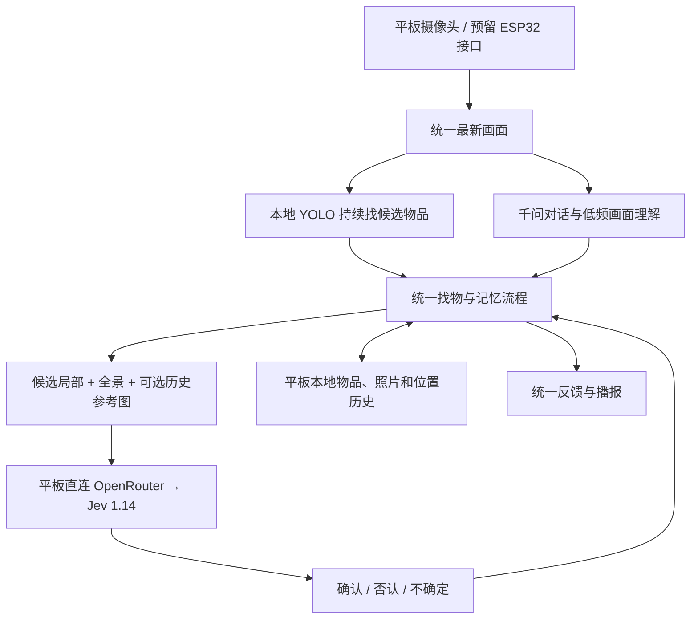

# OpenRouter Jev 图片复核：0.7.2

2026-11-01 已在小米 Pad 5 / Android 13 保留数据安装 **0.7.2-tablet-openrouter**，实际调用通过并启用 `jev-openrouter`。平板直接访问 OpenRouter，不需要电脑或自建服务器参与运行。0.7.1 的 TypeSafe 直连地区错误是另一条通道的历史结果，不能据此判断 OpenRouter 不可用。

## 当前分工

千问继续负责实时对话，Jev 接管独立图片复核。语音断开不阻塞图片复核。每次只使用所选的一个复核服务；Jev 否认或不确定时，不会自动改问千问以获取肯定结果。可以手动切回千问图片复核。

这仍是联网使用云端模型，没有把 Jev 模型离线放进平板；不向 Jev 连续上传视频。

## 已获得的实际结果

| 检查 | 结果 | 本次耗时 |
| --- | --- | --- |
| 电脑 OpenRouter Jev 文本请求 | HTTP 200，有效结果 | 约 1.0 秒 |
| 实际平板：普通图片复核 | HTTP 200，确认 | 2.068 秒 |
| 实际平板：当前图与三张参考图比较 | HTTP 200，确认 | 1.328 秒 |

图片检查使用应用现场生成的橙色图案和同一图案的参考照片，没有读取私人照片、相机或麦克风，也没有建立千问语音会话。上述结果证明平板图片与参考图调用可用，**不能代表真实物品准确率，也不能代表长期平均耗时**。

调用固定为官方 `https://openrouter.ai/api/alpha/decisions`，请求模型 `typesafe/jev-1.14`。电脑实际返回版本为 `typesafe/jev-1.14-20261014`；解析同时接受这两个明确标识，其他模型不能确认物品。全景、候选局部和最多三张参考图继续使用独立图片资产，保留原有清晰度、身份判断、取消和过期保护。

## 设置与密钥

右上角 `•••` → `图片复核设置` → 通道选择 `OpenRouter`。这台平板已完成密钥导入、图片测试和启用，无需重复配置。

- OpenRouter 和 TypeSafe 使用各自的密钥、加密存储和验证状态，不能混用。原 TypeSafe 配置已核对保持一致。
- 密钥通过加密方式导入平板，使用安卓安全存储加密保存；不回显已有密钥，没有写入源码、安装包或普通报告。
- 新保存或更换密钥后，必须先通过普通图片和参考图检查，再启用对应 Jev 通道。
- 调用失败会说明问题；不会把原始服务响应或密钥显示在界面。不跟随跳转把密钥发到其他地址。
- 可选择“使用千问图片复核”。“移除当前通道保存的密钥”只处理当前选定通道，不删除物品、对话或另一通道的密钥。

计费来自用户自己的 OpenRouter 账户；本次没有购买会员、充值或修改计费设置。没有修改平板的代理、DNS、VPN或其他网络配置。

## 验证与数据保护

55 项基础检查、静态检查和签名检查通过；模拟器 39 项安卓检查通过，包含原有记忆保护、独立复核、取消与过期处理，以及新增 OpenRouter 请求、模型验证、错误脱敏和两种密钥的隔离检查。

真机安装包与构建产物摘要一致；数据库完整、版本仍为 3，原有三条对话逐字一致。更新前后物品和位置表均为空，没有在真机写入假物品。本轮只更新和检查本项目测试应用，未修改其他应用或用户文件，未在平板安装自动检查辅助包。结束时相机与麦克风均未运行。

## 接下来

用真实物品检查“记住 → 重开 → 找到”的完整过程，以及同名不同物、遮挡、相似颜色、移动后位置历史和语音断开时的独立复核。记录误认、拒绝、不确定和等待时间，再决定是否调整判断条件。当前只证明图片调用和生成图判断通过，还没有完成上述准确率验收。

ESP32 固件由队友负责，保持接入统一画面的接口。Supabase 等到需要跨设备同步时再接入，不阻塞本地保存与历史查询。

官方依据：[OpenRouter Jev 接入](https://openrouter.ai/docs/guides/community/jev)、[图片与资产格式](https://openrouter.ai/docs/guides/community/multimodal-decisions)。本轮报告与安装包位于 `output/android-openrouter-2026-11-01`；私有数据备份和密钥不进入交付文件。
