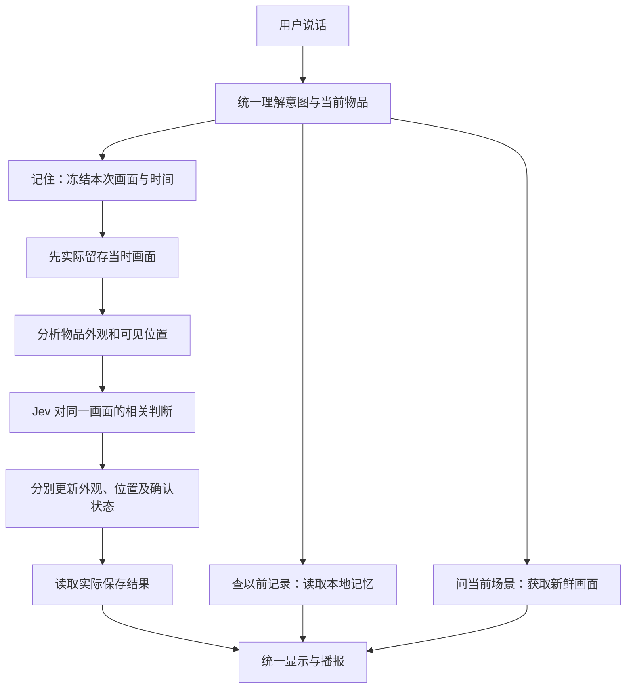

# 记忆流程重新梳理

日期：2026-11-02。下文保留现场失败后的审查和设计依据。后续已形成 0.11.0 的统一流程实现并更新平板，实际范围和验证边界以 [当前说明](android-controlled-memory.md) 及交付报告为准，不将本设计文档视为现场验收通过。

## 这次实际发生了什么

已通过只读方式核对平板上的 0.10.0 版本。应用记录了“暂未保存”，随后千问又说“记住了”，并复述了杯子的外观和桌面位置。正式物品库仍只有原来的 1 件物品、0 张外观照片、1 条用户口述的位置记录，没有本次自动保存的照片或位置。千问能复述，只说明它的当前对话里有这些内容，不能证明写进了物品记忆。

这次没有截取或上传新画面，没有调用模型，没有修改平板记录。此前用户批准的固定图片回放通过，仍只证明那一张图片；65 项基础检查和 84 项安卓检查也不能替代本次失败的现场验收。当前自动记忆功能未验收通过。

## 需要纠正的四个问题

1. **两路各自回答。** 本地任务保存失败后恢复千问播放，但没有把已生成的回答与任务结果绑定；千问也没有收到可信的保存结果。提示词说“不要宣称成功”没有形成程序上的限制。
2. **把三个判断绑成一个门槛。** 当前要求看见目标、图片清晰、物品范围都通过，才开始保存；照片范围没确定也会导致整次记忆失败。应当分开处理画面留存、物品外观提取和位置确认。
3. **失败原因被合并。** 服务未就绪、返回格式不完整、目标不确定等情况会变成相同的“完整入镜”建议。这次没有记录每一项判断，因此还不能确定现场究竟是哪项未通过。不得把原因直接归咎于用户没有拍全。
4. **意图和历史查询没有统一。** “你记住那个杯子在哪里吗”会落到普通聊天；“那我的水杯在哪里”会把“那我的水杯”当成物品名称。模型的对话内容和数据库里的历史因此混在了一起。

代码依据：`AssistantOrchestrator.captureMemory/learningFailed/collectQwen`、`JevDirectProtocol.memoryObservation`、`JevDirectVerifier.verify`、`AoqQwenRealtimeClient.setTaskMode/handleEvent`、`FindDialogueEngine.intent/extractTarget`。这次只读数据核对的脱敏结果见交付目录 `manual-live-trial.json`。

## 统一职责

| 部分 | 负责什么 | 不能越权做什么 |
| --- | --- | --- |
| 千问 | 听懂话、解析意图与指代、描述画面、组织普通回答 | 自行宣布已保存，或用聊天内容冒充物品库记录 |
| 本地统一核心 | 选择目标、保存和查询、处理取消、决定最终回复 | 把模型猜测或未成功的保存说成已确认 |
| Jev | 对指定画面中的目标、范围、位置或身份给出独立判断 | 决定数据库是否实际写入成功 |
| 安卓本地记忆 | 保存物品、照片、位置来源和时间，提供查询结果 | 因聊天回答而自动增加已确认事实 |
| 统一回复出口 | 根据本地处理结果显示和播报，丢弃过期回答 | 在同一轮播放互相矛盾的成功和失败反馈 |
| Supabase | 备份、恢复已经存在的本地记录 | 代替识别、意图理解或本地保存 |

安卓工程、相机/ESP32 统一输入、现有数据库和备份可以继续使用。需要重整的是上述协调关系。YOLO 继续辅助找物，不作为保存当时画面的前提。

## 用户说“记住这个杯子”的目标流程

1. **先理解意图。** 区分“记住它”“上次记在哪”“现在帮我找”“桌上有什么”。保留当前杯子的具体记录，理解“它”“这个”“我的杯子”；多件物品确实无法区分时，只追问一次必要信息。
2. **先留住本次画面。** 用户发出记忆指令后，保存这一刻的场景、时间和画面来源。无需三个角度，不先要求记忆库有相似物品。没有有效画面或写入失败时，明确说本次未保存。
3. **外观、位置分别处理。** 清楚的目标范围可以生成目标照片；暂时裁不出杯子时，不丢弃已留存的场景，也不把整张场景当成精确的杯子外观。位置根据同一画面中的参照记录，例如“黄色桌面上，旁边有透明水瓶”；不能仅凭外观颜色猜房间。
4. **Jev 的结果保留含义。** 物品是否可见、范围是否清楚、位置是否确认分别处理。不同结果不能全部变成“没完整入镜”。Jev 未确认的位置可以留为待确认的观察，不能标成已核实的位置；用户无需重新说地点来补救系统失败。模型对当前会话的自由复述不能直接当作确认依据。
5. **最后按实际结果说话。** 画面、照片、位置保存到什么程度，就反馈到什么程度。完整保存才说“已记住杯子的外观和位置”；只留住场景就说“画面已保存，杯子的具体位置还没确认”；写入失败就说“这次没有保存”。这三种情况都不能随后出现千问自行宣布的“记住了”。

同名物品不能仅凭同一类别就合并。先用当前选中物品和已有照片判断是更新还是新增；确实有歧义再询问，不把“先证实记忆库里有同款杯子”作为第一次记忆的前提。

“已经留存画面”“已提取目标外观”“位置待确认”“完整保存”等状态必须在原有物品记录中可读，不增加设置页或用户需要操作的新按钮。保存未完成的状态不能在历史查询时变成已确认的地点。

## 后续提问怎样回答

| 用户的话 | 正确依据与行为 |
| --- | --- |
| 你记住那个杯子了吗 | 查本地实际保存状态；未保存就承认未保存 |
| 上次杯子在哪里 | 查带时间和来源的位置记录，不直接复述聊天 |
| 杯子现在在哪里 | 看新画面或启动找物，历史记录只能当线索 |
| 桌子上面有什么 | 普通场景问答，不能改写长期记忆 |
| 它的外观是什么 | 读取对应物品已保存的外观；不足时说明不足 |
| 取消／先别记了 | 取消本轮处理，迟到结果不能覆盖后来的一轮 |

因此，最小的意图分流和统一回复必须与记忆一起处理，不能全部推迟到记忆做完以后。更丰富的聊天能力仍可以后续扩展。

## 回复控制的实现约束

当前千问使用会自动生成回答的实时通话模式；本地暂停播放器不等于服务端不生成回答。普通回复恢复时，也不能把先前那一轮不受信任的声音重新放出来。

实施时需由应用控制最终可听到的内容。优先验证当前通道能否只返回待处理的文字/工具结果，再由现有统一播报出口说出经核对的内容；不能仅追加一句提示词，也不能只做几个“已记住”关键词的过滤。是否能沿用当前通道及音色，要以当前 SDK 的实际验证为准，不预先宣称已经支持手动轮次。阿里云官方说明指出实时通话的 WebRTC 路径仅支持 VAD 模式，故不能直接把其他通道的手动模式参数照搬过来。[官方实时交互说明](https://help.aliyun.com/en/model-studio/realtime)

诊断只记录任务、画面编号、耗时、失败类别以及各判断项的数值，不默认保存现场图片、语音或密钥。没有分项证据时不擅自降低判断门槛；不能靠固定测试图片的一次成功调到“看起来通过”。

## 下一步实施顺序与验收

1. 先把“保存结果”和“查询历史”的回答统一到本地事实，验证失败后不会再有另一声音宣称成功。
2. 增加最小意图理解和当前物品上下文，覆盖本次真实失败的几种说法，避免再创建“那我的水杯”之类错误目标。
3. 将留存画面、提取外观、确认位置拆开，增加明确失败原因，再根据实际失败项处理识别问题。
4. 用不同实物和不同桌面做完整流程验证：记住 → 查记录 → 结束并重开 → 再查 → 带照片备份恢复。覆盖弱网、取消、同名物品、无目标和画面模糊。

验收必须同时满足：能实际留存；外观和位置状态准确；重新打开后能读到；查询来自记忆库；界面和声音一致；失败时不虚报。固定图片、模拟器或模型复述任何一项单独通过，都不算自动记忆完成。
