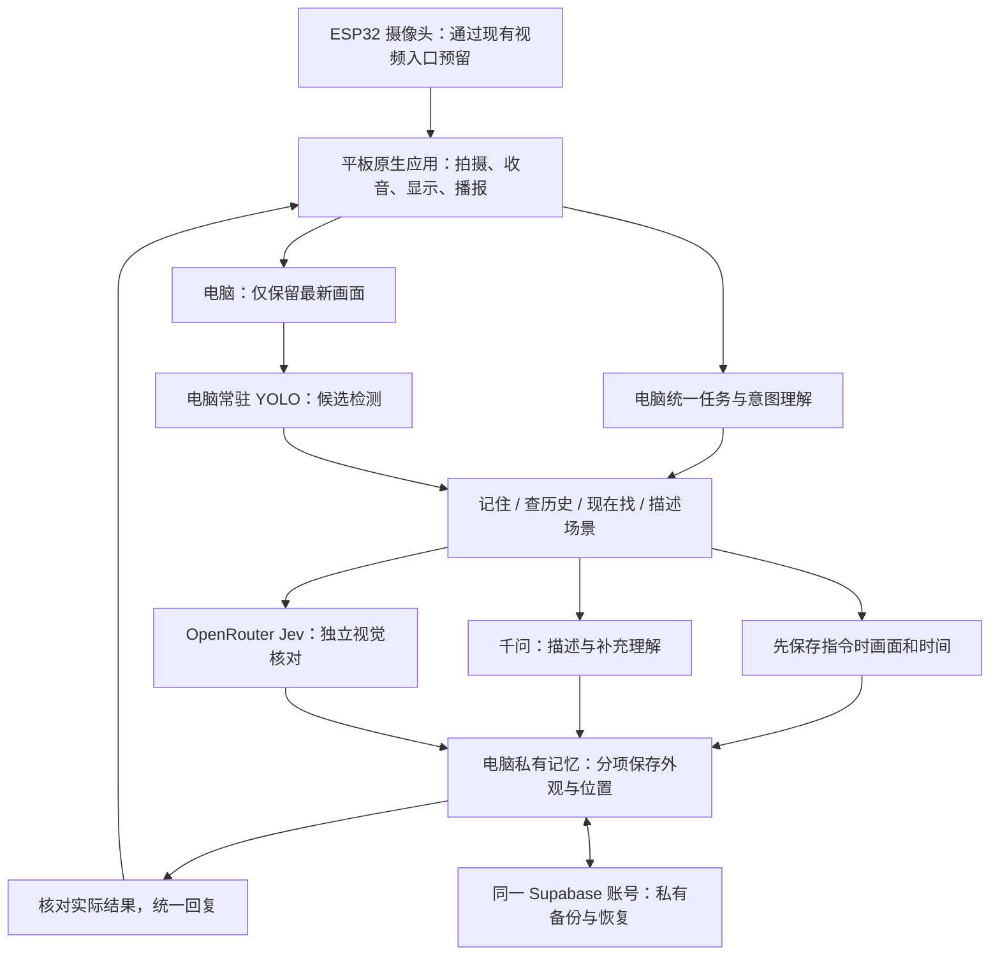

# 电脑处理版架构与迁移

2026-11-04，0.15.0。开发分支 `codex/pc-gateway-memory`，保留旧安装包与平板原始数据。

## 迁移原则

- 电脑是 0.12 的任务与新记忆唯一管理者；平板保留迁移前本地库。记录查看、修改、删除以及位置历史使用电脑记录，避免界面读旧库而声音读新库。
- 首次登录电脑，先恢复既有云端快照，再导入平板较新记录。失败时不上传一份不完整的新快照。重复导入同一份平板数据会跳过，避免以后把电脑已删除的旧记录重新带回。
- 新的同名物品使用独立身份。查询多件同名物品时沿用已有选择方式；“另一个杯子”可另存新物品。
- 备份继续是原项目的私有不可覆盖快照，未增加 SQL 准备步骤、表单或图片复核设置页。电脑与平板用户身份必须一致。
- 电脑新记忆默认在 `pc-gateway/runtime/memory/`，配对及本机证书在 `runtime/`。个人数据、服务密钥、配对凭据不进 Git。

## 实际行为

1. **理解**：明确指令先分流，较自然说法通过千问纯文本接口补充；模型结果仍由电脑检查。普通清晰问题可以直接回答，含义不清才澄清。当前位置、历史位置、是否保存和普通场景描述分开处理；“它”关联当前选中物品。物品名称去掉“帮我把这个”等指令前缀。
2. **捕获**：“记住这个杯子”冻结电脑收到的最新有效画面，先保存画面和取景时间。目标照片、可见相对位置分别确认；无需口述地点或三个角度。
3. **核对**：千问描述与指令当帧的本地检测同时开始。唯一检测候选可直接交 Jev 核对，与千问并行；无本地候选时使用千问建议的目标范围，再让 Jev 对候选和地点假设独立核对。无法得到范围时仍可使用 Jev 框选。外观与位置分别检查；明确否定的候选不重复提问直到获得肯定。确认位置只描述可见参照，不猜房间。
4. **保存**：当前画面、外观描述和相对位置先作为相机观察写入，再独立复核；目标裁图可选。复核不确定不丢观察，明确否定则标记分歧并停止把它作为有效线索。并发修改后不允许迟到结果覆盖记录。
5. **回复**：自由聊天音频继续被抑制；原生统一播报只接收本地已经写入的结果。相机观察与独立核实保持区别。后续查询读取真实记录。用户提新问题后，旧结果可完成保存，但不打断新回答。
6. **寻找**：常驻 YOLO 给出多个候选。独立核对否定第一件后可换另一件；“不对”和“继续找”分开，补充特征只作用于本轮。没有检测候选时限频整图复核，私人目标仍要求参考照片和个体匹配。
7. **结束**：“拿到了”可记录用户确认，不要求一定先由模型找到；后续查询说明拿到后的新地点尚未记录。

## 0.14 回答与响应优化

- 场景描述取消“最多三个物品”的提示和校验。千问按问题给连贯描述，覆盖清楚可辨认的物品、家具、背景及方位；不承诺列尽模糊、遮挡和画面外的东西。
- 图片接口按任务给固定输出额度：场景 480、记忆 320；旧客户端仍使用 120。短格式避免让记忆分析重复输出场景清单，也避免长描述被旧额度截断。
- 常见指令直接本地分流。复杂表达与普通问答走独立文本意图接口，不再等待平板实时语音工具队列；纯文本真实测试约 2.8 秒。
- 收到记忆或观察指令后显示处理状态，不播“当时画面已保存”作为中间答复。记忆分析完成后只播实际结果，完整保存与部分保存仍区分。
- 每轮回答带顺序约束。旧意图请求失败不能追加到新问题之后；内部错误码进入诊断，不进入回答。取消与新会话仍中止旧任务。
- 真实公开图片检查完成目标照片、描述和位置保存；图像测试未使用私人现场画面。多轮测量中，场景约 5～7 秒、完整记忆约 7～9 秒，仍受云端模型和网络影响。这些是电脑处理时间，不含语音转写和播报，不能据此宣布低延迟目标已完成。
- 本次验证 46 项电脑/图片接口检查、74 项安卓单元检查及 3 项安卓与电脑互通检查。平板覆盖更新到 0.14，原聊天逐条保留；测试期间用户新增的聊天也保留，物品库、图片、Jev 配置与配对均已核对。

Jev 框选的返回格式、存在性核对与早期能力限制参考 [OpenRouter 官方说明](https://openrouter.ai/docs/guides/community/jev)。本版增加候选框核对以减少对其自行框选的依赖，没有降低确认阈值。

## 0.15 风扇记忆与窗口修复

- 已定位用户实际问题：同一个小风扇对象已有一张目标照片与一条核实位置，但原回答只读最后一张采集的状态，交替要求补外观/位置。现在汇总已有信息，同时保留各自时间；旧位置明确称“上次记录”，不冒充当前重新确认。
- 千问明确看到的外观和相对位置先写入场景记录的 `description/suggestedLocation`，标记 `REVIEW_PENDING`。界面和语音从已落盘结果作答，不等待独立复核。参考场景可以用于后续辨认，不强制先裁出独立照片。
- Jev 后续通过可补照片/核实位置；不确定标 `REVIEW_UNCERTAIN`，服务不可用标 `REVIEW_UNAVAILABLE`，均保留已存观察。明确否定标 `REVIEW_REJECTED`，该次位置和参考图不再作为可靠线索。既有原图不删除，原描述可以回退。
- 观察地点通过场景字段持久化，位置历史显示为 `CAMERA_OBSERVED`；只在独立核实时写入 `CAMERA_VERIFIED`。没有修改备份版本或放宽原有来源校验，场景字段与复核标记可通过 v2 备份恢复。
- 普通记忆指令复用唯一的同名对象，“风扇/小风扇”共用查询；多件时仍要求选择，明确“另一个”另建身份。“它/他/她”按上下文指同一件物品，缺上下文则澄清，不再创建名为“他”的新物品。已有错误命名记录保留。
- 新版安卓的指令请求立即返回接收确认，结果经统一通道返回，等待复核时可继续输入。新问题不会留下旧的“正在记住”状态；语气词不会取消待完成回答。取消语音连接不会在首页残留“语音失败”。
- 聊天气泡改为父容器宽度并自动换行，输入/发送固定在对话滚动区域外。已通过长消息换行及页脚可见性检查，并在小米平板核对实际界面。
- 验证：57 项电脑/接口检查、74 项安卓单元检查、10 项安卓模拟器检查。真实公开风扇图完成“描述→记住→用‘他’查询→重开读取”：本轮描述约 5.8 秒、记忆首次答复约 5.8 秒、查询约 0.05 秒，独立复核完成前已经作答。首次场景测试曾超时，随后明确区分连接慢与没看清画面，并完成复测；未宣称稳定低延迟。
- 小米平板已覆盖更新至 0.15；159 条聊天、原物品库与图片、Jev 配置和配对均已核对。电脑原 5 件物品完整内容未变。只读查询用户原来的小风扇，已读回外观和“桌面上”的历史位置，且“他”解析到同一编号。本轮未将用户新的现场画面发送给测试脚本。

公开风扇测试图为 [Wikimedia Commons 的 A mini table fan](https://commons.wikimedia.org/wiki/File:A_mini_table_fan.jpg)，作者 Ugwuba Alumma Rita，CC0-1.0；只用于检查，不是用户现场验收图。

## 会话与 30 天历史

- 在原有“记录”窗口查看“当前对话”“历史”“物品记忆”。点击“新会话”，或在文字输入框发送“新会话”，立即开始空白会话，不必等历史到期。
- 新会话停止当前采集和任务，断开千问语音会话，同时清除电脑端的当前物品、候选、临时特征和指代。旧任务迟到的分析结果不能写入或回答新会话；此前已保存的场景保留。
- 聊天文字按消息时间保留最近 30 天，在打开应用、查看记录和追加消息时清理。历史只供查看，打开旧历史不会继续旧模型上下文。当前会话也已过期时会自动创建新会话。
- 旧版聊天没有时间戳。升级后整体移入“以前的对话（日期未记录）”，从迁移日起保留 30 天；迁移提交成功后才移除原列表，重复打开不重复导入。
- 物品记忆、照片、位置历史和 Supabase 私有备份独立于聊天历史，聊天到期与新会话都不删除它们。聊天历史目前保存在平板，未加入 Supabase 物品备份。
- 安卓与电脑服务须一起更新到 0.13；新版安卓会检查电脑是否支持会话重置，避免仅清空界面却延续旧任务。

## 已接入与边界

安卓保留原相机与 ESP32 来源切换、千问实时转写、原生播报、记录界面和加密登录。固定图片描述使用原千问服务，Jev 沿用已验证的 OpenRouter 接口。电脑模型在本地运行；千问、Jev 和 Supabase 需要互联网。

平板回到应用前台会尝试恢复已配对电脑连接；相机和麦克风需点击原来的“语音找物”开启，切到后台会停止采集。电脑与平板处于不同网络时，需要同网后重新配对。2026-11-04 已在同一手机热点完成 Wi-Fi 配对，验证时移除了本应用的 USB 端口转发。

ESP32 固件没有修改，当前沿用安卓已有接口转发其画面到电脑。真实板子联调仍由后续硬件阶段完成。电脑独立拉 ESP32 视频流、用户确认后自动追加新参考角度，以及精确房间定位均未在本轮宣称完成。

首次迁移保留原 App 数据备份和原安装包。不得通过卸载、清空数据、重置网络或安装系统证书解决接入问题。

## 验收标准

- 电脑重开仍能读回场景、照片、位置来源及部分保存状态。
- 安卓 v1/v2 备份可导入电脑；电脑 v2 备份可恢复到独立安卓库；同名身份、场景及位置来源一致。
- 同一 Supabase 私有账号上传、下载摘要一致，独立库可恢复，匿名读取被拒绝。
- 实景仍要覆盖“一句话记住 → 问记住了吗 → 查上次位置 → 重开再查”，另测两只相似杯子与不同镜头角度。公共图片、模拟云接口和历史回放不能代替这项验收。

## 本次验证记录

- 0.12.0 通过 USB 覆盖安装到测试平板。应用回到前台后，电脑服务检测到 USB 转发连接。安装前后的数据库记录、117 条原有对话和加密配置已核对。
- 电脑端 29 项测试和新版安卓 3 项互通测试通过，覆盖配对、旧备份恢复和记忆保存后查询。本地 CPU 上的 YOLO 用公开公交车图完成四轮检测。
- 原 Supabase 账号中的 2 件物品和 1 张场景图完成上传、下载校验和独立恢复。千问图片请求首次失败，用同一公开测试图复测通过。Jev 返回了有效的“不确定”结果。
- 真机测试运行器的安装已取消。真实相机与语音的连续操作、ESP32 实机联调仍待验收。
- 2026-11-04 Wi-Fi 联调中，电脑 `172.20.10.7` 收到平板 `172.20.10.3` 的实际无线会话。千问公开图片请求成功，Jev 返回有效的“不确定”结果，原 Supabase 账号完成备份、下载校验和独立恢复，匿名读取被拒绝。测试未采集新的现场画面或声音。
- 0.13.0 通过 74 项安卓单元检查、31 项电脑端检查、9 项安卓模拟器检查；新增覆盖旧聊天迁移、30 天边界、同一会话内旧消息清理、新会话按钮和两端指代重置。
- 当前电脑服务已更新至 0.13.0，本地 YOLO 就绪；更新前后两件既有物品的完整记录摘要一致。升级没有采集新的相机或麦克风数据。
- 2026-11-04 已将 0.13.0 覆盖更新至小米平板，升级前留存本应用数据与旧安装包。118 条原聊天逐条核对后完整进入“以前的对话”；原物品库全部记录及图片文件摘要保持一致，电脑端两件物品记录也未改变。真机点击“新会话”后身份变化、当前聊天为空，历史仍可查看，物品界面成功读取电脑记录。
- 备份账号的旧登录可以解密，过期会话已正常刷新；Jev 配置和 Wi-Fi 配对内容保持一致。平板使用 `172.20.10.3` 与电脑 `172.20.10.7` 无线连接，无 USB 8765 端口转发。本次未开启相机或麦克风，未安装测试运行器、清空应用或操作其他应用。
